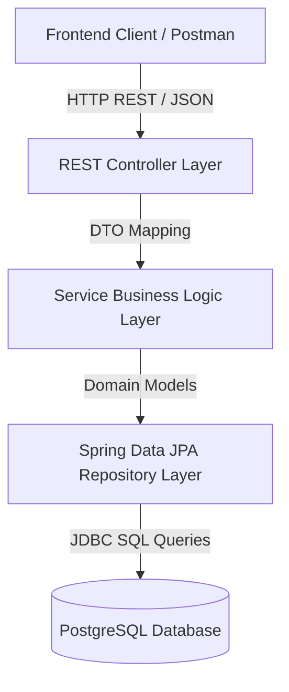
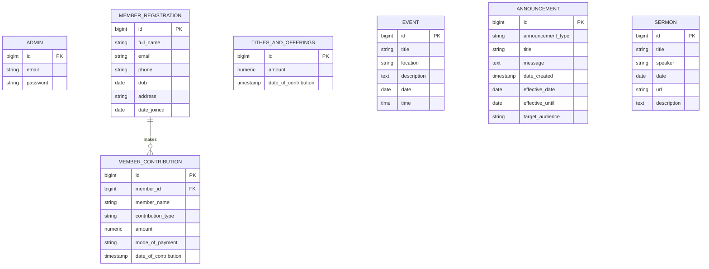

# System Architecture & Database Design

## 🏗️ Architecture Overview

The **Church Management System (CHMIS)** backend follows a standard 4-tier layered architecture:

### Layer Descriptions

1. **Controller Layer (`com.example.church_management_system.controller`)**
   - Handles incoming HTTP REST requests.
   - Enforces endpoint mappings and CORS configuration.
   - Delegates business execution to services.

2. **Service Layer (`com.example.church_management_system.service`)**
   - Contains core domain logic and transactional boundaries (`@Transactional`).
   - Handles DTO <-> Entity mappings.
   - Executes validation and security logic.

3. **Repository Layer (`com.example.church_management_system.repository`)**
   - Provides JPA data access methods extending `JpaRepository`.
   - Executes standard CRUD and custom derived query methods.

4. **Domain Model Layer (`com.example.church_management_system.model`)**
   - JPA Entities mapped to PostgreSQL tables (`member_registration`, `event`, `announcement`, `sermon`, etc.).

---

## 🗄️ Database Entity Relationship (ER) Diagram

